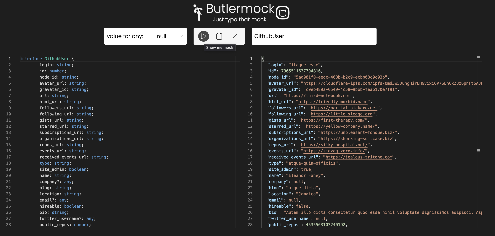
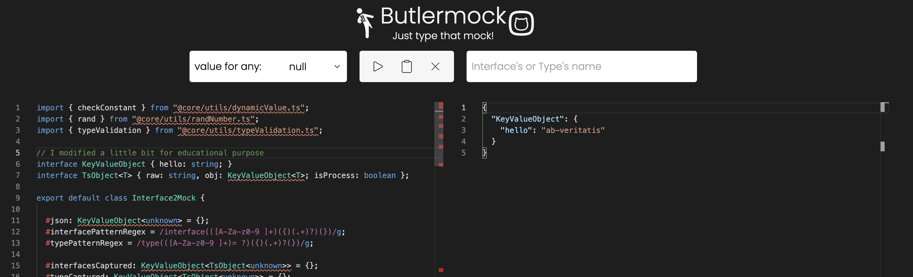

# Butlermock

[](https://fresh.deno.dev)

<a href="https://www.buymeacoffee.com/devrafx" target="_blank"></a>

Tool for building mocks from typescript's types/interfaces into object
with actual data using Fakerjs

> Documentation on develop, in the near future I will expose the endpoints for you to use it within your client application, so, stay on tune 🐒

# Table of contents

<!--ts-->

- [Web usage](#web-usage)
- [API usage](#api-documentation)
- [Example as package/library](#Example-as-package/library)
- [FAQs](#faqs)
- [Limitations](#limitations)
- [Status](#status)

<!--te-->

# Web usage

Just go to https://butlermock.online/ and in the left panel paste your interfaces or types, just be aware of the [current limitations](#limitations)

Wait until the monaco editor shows up and paste your interfaces to later clicking the play button and the mock shows up almost immediately.



> 

> The "play" button mocks up, "clipboard" copies the mock created and the "X" button is for cleaning the view

# API documentation

Easy peasy

```typescript
fetch(new URL("/api/mock", "https://butlermock.online").href, {
  method: "POST",
  headers: {
    "content-type": "application/json",
  },
  body: JSON.stringify({
    value: `interface Test {
        Hello: "World!";
        }`,
    valueForAny: "null", // any parseable json value, values: "null" | "\"Whatever the text you want\"" | "{}" | "0" | "1" | ... | "9"
    mustReturn: "", // empty or the top-level name of the interfaces that you provided
    quantity: 1, // if is greater than 1, the api response will be an array of the interfaces provided
    seed: 42, // optional: the same seed and source always return the same mock
  }),
})
  .then((res) => res.json()).then(console.log); // should log:
//{
// "Test": {
//    "Hello": "World!"
//  }
//}
```

| field         | required | description                                                                                                                             |
| ------------- | -------- | --------------------------------------------------------------------------------------------------------------------------------------- |
| `value`       | yes      | TypeScript source with your interfaces, types and enums (up to 100 KB).                                                                 |
| `valueForAny` | no       | JSON text used for `any`/`unknown` values and unresolved generics. Defaults to `"null"`.                                                |
| `mustReturn`  | no       | Name of the interface/type to return. Empty returns an object keyed by every declaration.                                               |
| `quantity`    | no       | Integer from 1 to 10. Above 1 the response is an array of mocks. Defaults to 1.                                                         |
| `seed`        | no       | Integer. Makes the output repeatable; with `quantity` above 1 every item uses the next seed, so a batch is repeatable but not repeated. |

Invalid requests (malformed JSON, a source with syntax errors, an unknown `mustReturn`, `quantity` out of range, ...) answer **400** with `{ "error": "..." }`. `bigint` values are returned as strings.

> Members no longer need a trailing `;`, the source is read by the TypeScript parser, so anything that is valid TypeScript works. If the source has a syntax error the API tells you the line and column.

### Recommedations when using the API

If you are going to consume the API I suggest that you use fetch() instead of your own HTTPS calling implementation, to avoid sending credentials which I don't store, but security reasons try to use it in the way I suggest, just for privacy reasons. **REPEATING, I DO NOT STORE ANY DATA. :)**.

# Example as package/library 👷🏻‍♂️🚧

[Check here](https://github.com/Devrax/Butlermock-package) > Under construction 🚧

# Guide when providing an interface or type to be mocked up

```typescript
const mock = new Interface2Mock(`interface Greeting {
    hello: string;
    cursed: {
        damn: string;
    }[];
  }`); // ✅ Inline objects are mocked too

mock.buildMock("Greeting"); // { hello: "...", cursed: [{ damn: "..." }, ...] }
mock.buildMock(); // { Greeting: { ... } }, one key per interface/type/enum
```

```typescript
// Optional third argument: a seed for repeatable output and the recursion limit
const mock = new Interface2Mock(source, null, { seed: 42, maxDepth: 3 });
```

# FAQs

### **Q: Is it using an AI?**

A: No :)

### Q: How can I tell the API or website to give me a fixed value?

A: You just type explicitly the value you want:

```typescript
interface ThisIsSparta {
  troops: 300;
  leader: "Leonidas";
  murderedBy: true;
}

interface mightBeSparta {
  troops: 200 | 594 | 2893 | 39;
  leader: "Trump" | "Me" | "You?";
  murderedBy: true; // fixed Booleans can not be multiples values, for that use explicitly 'boolean'
}
```

### Q: Can I copy full code snippet and it will detect the interfaces?

A: Yes :), as long as it is valid TypeScript (JSX is not supported). Every `interface`, `type` and `enum` is detected, including the ones inside `namespace` blocks.


# Limitations

This section is for known limitations that Butlermocks has, but in the future might be able to recognize and mock:

| type                     | example                                         | description                                                                                                                                                                        |
| ------------------------ | ----------------------------------------------- | ---------------------------------------------------------------------------------------------------------------------------------------------------------------------------------- |
| Recursive types          | `interface Node { children: Node[] }`           | A type is expanded at most 3 times inside itself (`maxDepth`); past that, arrays are empty and objects are `null`.                                                                 |
| Unresolved generics      | `interface Box<T> { value: T }` mocked as `Box` | A type parameter without an argument or default gets the `valueForAny` value.                                                                                                      |
| Unknown generic wrappers | `Promise<User>`, `Map<string, User>`            | Generic types that are not declared in the source and are not `Array`, `ReadonlyArray`, `Partial`, `Required`, `Readonly`, `Pick`, `Omit` or `Record` get the `valueForAny` value. |
| Unknown types            | `owner: User` without declaring `User`          | Become `null`.                                                                                                                                                                     |
| Advanced type operators  | `typeof x`, conditional types, `infer`          | Get the `valueForAny` value.                                                                                                                                                       |
| Functions                | `onClick(): void`, `callback: () => void`       | Methods and function-typed members are left out of the mock.                                                                                                                       |
| Classes                  | `class User { ... }`                            | Only `interface`, `type` and `enum` declarations are mocked.                                                                                                                       |
| fixed string             | `"a\; b\: c"`                                   | Escaping `;` and `:` inside fixed strings is no longer required, but it is still accepted, so `"a\; b"` and `"a; b"` both produce `a; b`.                                          |

# Status

- [x] _Interfaces_

```typescript
interface NonMockeableInterface {} // ❌ empty interface

interface MockeableInterface {
  somethingToMock: any;
} // ✅ Mockeable

export interface AnotherMockeableInterface {
  anotherThingToMock: any;
} // ✅ Mockeable, 'export' and 'declare' are ignored
```

<br />

- [x] Interfaces with nested interfaces/types, and inline objects

```typescript
type mockeableType = {
  name: string;
}; // ✅ Mockeable

interface MockeableInterface {
  somethingToMock: any;
  nestedInterface: AnotherMockeableInterface;
  extraNestedInterface: AnotherMockeableInterface[];
  inline: { deeper: { value: number }[] };
} // ✅ Mockeable

export interface AnotherMockeableInterface {
  anotherThingToMock: any;
} // ✅ Mockeable, 'export' is ignored
```

<br />

- [x] Interfaces that extends from one or more interfaces/types, and intersections

```typescript
interface That { ... }
interface Other { ... }

interface This extends That, Other {} // ✅ Mockeable
type Both = That & Other & { extra: string }; // ✅ Mockeable
```

<br />

- [x] Generic Interfaces and types, with defaults

```typescript
interface This<T, U = string> {
  here: T;
  there: U;
}

interface Uses {
  value: This<number>; // ✅ { here: number, there: string }
}
```

<br />

- [x] Generic Interfaces that extends from other interfaces/types

```Typescript
interface Evnt<T> {
  name: T;
}

interface IPropertiesToAdd<T> extends Evnt<T> {
  on(): void; // methods are left out of the mock
  off(): void;
}

type Mocked = IPropertiesToAdd<string>; // ✅ { name: string }
```

<br />

- [x] Arrays, tuples and unions

```typescript
interface Lists {
  a: string[];
  b: Array<number>; // ✅ Array<T> and ReadonlyArray<T> are supported
  c: boolean[][];
  d: [string, number];
  e: "a" | "b" | "c"; // picks one of the literals
  f: string | number; // picks one of the types
  g: string | null; // may be null
}
```

<br />

- [x] Index signatures, enums and utility types

```typescript
enum Status {
  Active = "ACTIVE",
  Banned = "BANNED",
}

interface Dictionary {
  [key: string]: number; // ✅ 1 to 3 random keys
}

interface User {
  id: string;
  status: Status; // ✅ one of the enum values
  tags: Record<string, boolean>;
}

type Preview = Pick<User, "id" | "status">; // ✅ Partial, Required, Readonly, Pick, Omit, Record
```

<br />

- [x] Primitive Type

```typescript
type justString = string; // ✅ Mockeable
type id = `user-${number}`; // ✅ template literal types produce matching strings
```

Supported scalars: `string`, `number`, `bigint`, `boolean`, `Date`, `null`, `undefined`, `any`, `unknown`, `object`, `symbol` and literal values.

<br />

- [x] Recursive types

```typescript
interface TreeNode {
  children: TreeNode[]; // ✅ expanded 3 levels deep, then []
}
```
